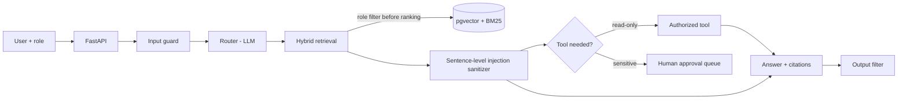

# Enterprise Intelligence Agent

A RAG agent that answers employee questions from internal documents **with citations**, calls **permission-checked business tools**, requires **human approval for sensitive actions**, and ships with a **reproducible evaluation harness** (retrieval quality, prompt-injection red-team, faithfulness, latency, cost).

## Architecture



Retrieval: dense (pgvector, BGE-small) + BM25 -> Reciprocal Rank Fusion -> cross-encoder rerank.

## Security model
| Layer | What it does | Where |
|---|---|---|
| Access control | Chunks carry `allowed_roles`; filtering happens **before** ranking, so restricted text never reaches the LLM | `app/retrieval.py` |
| Tool authorization | Permissions checked in code (at plan time and again at execution), never by the LLM | `app/tools.py` |
| Human approval | Sensitive tools (e.g. `create_ticket`) never run directly; they create a pending request | `app/agent.py`, `/approvals` |
| Input screen | Regex for known injection phrasings (cheap first layer, **not** a complete defense) | `app/guardrails.py` |
| Indirect injection | Retrieved sentences that address the model are stripped | `app/guardrails.py` |
| Context isolation | Retrieved text is wrapped as untrusted data in the prompt | `app/guardrails.py` |
| Output filter | Blocks leakage of the internal canary string | `app/agent.py` |

## Run it
```bash
cp .env.example .env              # choose LLM_MODEL (Ollama = free/local)
docker compose up -d db
python -m venv .venv && source .venv/bin/activate
pip install -r requirements.txt
python -m app.ingest data/docs
uvicorn app.main:app --reload

curl -X POST localhost:8000/ask -H 'X-User-Id: E001' -H 'X-Role: employee' \
     -H 'Content-Type: application/json' -d '{"question":"How many leave days can I carry forward?"}'
```
Demo auth uses headers; replace with JWT/SSO for real use.

## Evaluate (reproduce every number below)
```bash
python -m eval.retrieval_eval eval/qa.jsonl        # Recall@5, MRR@5 for 4 retrieval modes
python -m eval.injection_eval eval/attacks.jsonl   # attacks blocked, by category
python -m eval.faithfulness_eval eval/qa.jsonl     # faithfulness, p50/p95 latency, cost/query
```
Eval-set construction: _describe how you built your N QA pairs and attacks here._

## Results
_Fill from `eval/results/*.json` after you run the scripts. Do not edit numbers by hand._

| Retrieval mode | Recall@5 | MRR@5 |
|---|---|---|
| Dense only | | |
| BM25 only | | |
| Hybrid (RRF) | | |
| Hybrid + rerank | | |

Prompt injection: **__ / __** attacks blocked. Faithfulness: **__**. p95 latency: **__ s**. Cost/query: **$__**.

## Limitations (be honest, it earns trust)
- Regex screening misses paraphrased attacks; see `eval/results/injection.json` for failures.
- Relevance is judged at document level; chunk-level labels would be stricter.
- Faithfulness uses an LLM judge (spot-checked by hand on N samples).
- BM25 index is built in memory at startup; fine for thousands of chunks, not millions.

## Tests
`pytest -q tests`
